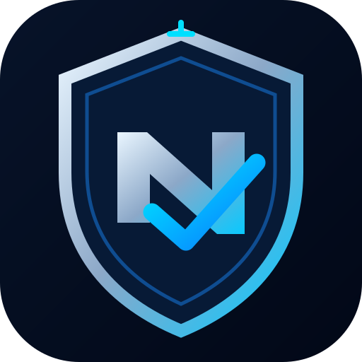

# NexGuard 🛡️

<p align="center">
  
</p>

<p align="center"><strong>Smart Protection. Better Communities.</strong></p>

<p align="center">
  <a href="https://t.me/NexGuardd_Bot">Open NexGuard on Telegram</a> ·
  <a href="docs/">Documentation</a>
</p>

<p align='center'>
  <a href="https://github.com/maxXkiller09/group-manegement-/actions/workflows/ci.yml"></a>
</p>

**NexGuard** is a Telegram group-management bot for **[@NexGuardd_Bot](https://t.me/NexGuardd_Bot)**, built with Go and gotgbot. It helps communities stay safer and better organized with moderation tools, filters, notes, greetings, anti-spam protection, CAPTCHA verification, backups, group analytics, and a Telegram Mini App dashboard.

## Quick Start

Prerequisites: Docker, Docker Compose, a Telegram bot token from
[@BotFather](https://t.me/BotFather), and a Telegram user ID plus log-channel ID.

```bash
git clone https://github.com/maxXkiller09/group-manegement-.git
cd group-manegement-
cp sample.env .env
# Set BOT_TOKEN, OWNER_ID, MESSAGE_DUMP, WEBHOOK_DOMAIN, and WEBHOOK_SECRET in .env.
docker compose up -d
docker compose logs -f alita
```

PostgreSQL and Redis are included in the Compose stack.

## Documentation

For setup, configuration, deployment, and command references, see
[the project documentation](docs/). For contributor and architecture guidance, see
[AGENTS.md](AGENTS.md).

## Metrics endpoint security

The `/metrics` and `/db_metrics` endpoints are disabled with **404 Not Found**
when `METRICS_AUTH_TOKEN` is empty. Set a strong, private
`METRICS_AUTH_TOKEN` to enable them; requests must then include
`Authorization: Bearer <token>`. Missing or incorrect tokens receive
`401 Unauthorized`. The public `/health` endpoint is not protected by this
metrics token and remains available for service health checks.

Do not expose the metrics token in logs, source control, or client-side code.

## Operational lifecycle logs

The configured `MESSAGE_DUMP` chat receives short HTML audit notices when a
user starts the bot in PM, the bot is added to or removed from a group, or
Telegram reports a group-to-supergroup migration. These notices contain
identifiers and event metadata only; they never copy message text or other
message content. Delivery is asynchronous, rate-limited, deduplicated, and
uses a bounded Telegram request timeout. If Telegram reports that the dump
chat cannot be found, lifecycle delivery is disabled for that process after
one warning; normal bot update handling continues.

## Development

```bash
make run
make lint
make test
```

## Upstream and License

NexGuard is maintained in this repository and builds on the upstream Alita Robot project. The upstream project and its contributors retain their original attribution.

[MIT](LICENSE) © 2020-2026 Divkix and contributors.
